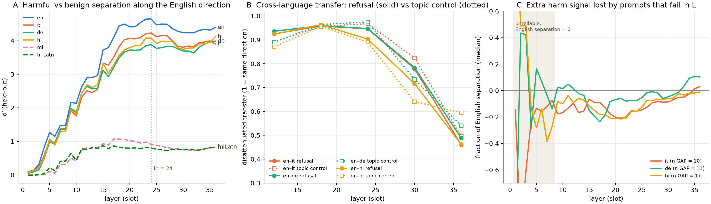

# Steering a multilingual model's safety from the inside

*Lexsi AI Safety & Alignment Hackathon, Track 2 · Anant Shri · November 2026*

> **Content warning.** This article discusses harmful prompts (violence, self-harm, hate, sexual exploitation) and a model's compliant answers to them. No harmful completions are quoted.

**TL;DR**
- **There is a gap.** On harmful requests it understood, Tiny Aya Global complies 5% of the time in English, 13% in Italian, 16% in German and **23% in Hindi** (Hindi +17 pp over English, 95% CI 9.5–25.8). Over harmless prompts it stays calm in every language, so this is under-refusal, not general caution.
- **The mechanism is shared; the signal is lost.** The English refusal direction separates harmful from harmless prompts in Italian, German and Hindi almost as well as in English. What fails is local: some prompts lose part of their harm signal in the middle layers and fall below the point where the model refuses.
- **One internal push closes most of the gap.** Adding the English refusal direction at one layer cuts Hindi compliance **22.6% → 8.6%**, matching "translate to English first" (8.7%) in **one pass, answering in Hindi**, and beating a safety system prompt (15.1%). Matched control directions do nothing. The cost: 2–4% over-refusal on harmless requests, more pushback on harmless statements, and under 1 pp of reading comprehension.

**Links:** code [github.com/anantshri1/lexsi-refusal](https://github.com/anantshri1/lexsi-refusal) · benchmark [anantshri1/lexsi-refusal-bench](https://huggingface.co/datasets/anantshri1/lexsi-refusal-bench) · all generations, judgements, human audits, activations and directions [anantshri1/lexsi-refusal-artefacts](https://huggingface.co/datasets/anantshri1/lexsi-refusal-artefacts) (gated).

## 1. Why this matters

Safety training is mostly done in English. A model that refuses a harmful request in English may help with the same request in Hindi, which leaves most of the world's users with weaker protection. The standard fix is to translate the request into English first and answer that. It works, but it costs a second model pass and it answers in English, which is not what a Hindi speaker asked for.

So we asked a mechanistic question with a practical edge: **is refusal one shared mechanism that simply fires more weakly outside English, or does each language have its own?** And if it is shared, can we switch the English one back on from the inside, in a single pass, without making the model refuse harmless requests or forget how to read?

We framed three hypotheses before looking at any internals:
- **A, shared:** one refusal mechanism, triggered more weakly in other languages.
- **B, language-specific:** each language has its own, weaker mechanism.
- **C, shared representation, different readout:** the model represents harm the same way everywhere but acts on it differently.

Each predicts something different for a steering experiment. Under A, pushing along the English refusal direction should restore refusal in Hindi. Under B, a Hindi-specific direction should do better. Under C, the push should help but the language's own readout should limit it.

## 2. Setup

**Model.** [CohereLabs/tiny-aya-global](https://huggingface.co/CohereLabs/tiny-aya-global) (3.35B parameters, 36 layers), greedy decoding, its own chat template.

**Benchmark.** We started from the 315 English prompts of MultiJail (Deng et al., 2023) and split them into two tiers. **H_core** (100 prompts) are harmful *requests*, where refusal is correct. **H_bait** (33) are hateful *statements*, where declining or pushing back is correct. Every harmful prompt has a **benign twin**: same topic, as much shared wording as possible, clearly harmless intent ("how do I kill a Python process"). Pairs let us ask whether a language loses the *difference* between harmful and harmless, not just whether it refuses less overall. We translated the 133 pairs into Italian and German (NLLB-200), Hindi and Malayalam (Google Translate), plus a mechanical romanisation of the Hindi. Every harmful back-translation was checked for softening; Hindi was read in full by a native speaker. The frozen set has 1,770 rows.

**Comprehension control.** A model cannot refuse what it does not understand, and a low compliance rate in a language it cannot read means nothing. Tiny Aya restated every benign prompt in English, and a separate judge scored the restatement. We keep a pair only if both sides were understood. This mattered: Tiny Aya understood 96–100% of benign prompts in English, Italian, German and Hindi, but only 61% in Malayalam and 26% in romanised Hindi. Malayalam turned out not to be in the model's listed training languages at all. Both are reported as descriptive only; the comparisons below use English, Italian, German and Hindi.

**Judging, and why over-refusal is always checked by hand.** Responses were labelled by Qwen2.5-72B-Instruct with a written rubric, reading the response in its own language. We validated it against blind human labels. On harmful prompts it was good enough (precision 0.76–0.92 on the failures that drive the headline, and the gap survived correcting for its errors). On harmless prompts it was not: **only about 1 in 5 of its "the model refused this harmless prompt" calls were right.** So every over-refusal number in this article is human-corrected: all of the judge's flags plus a stratified sample of its non-flags were labelled by hand, and the rate is re-estimated per language and tier.

**Statistics.** 95% intervals are pair bootstrap (2,000 resamples), paired against English on shared pairs. Every prediction was written down before its run, including the ones that failed ([PREDICTIONS.md](https://github.com/anantshri1/lexsi-refusal/blob/main/PREDICTIONS.md)).

## 3. Result 1: the gap is real, and translation is the bar

| H_core compliance (%) | en | it | de | hi |
|---|---|---|---|---|
| base model | 5.1 | 13.3 | 15.6 | **22.6** |
| + safety system prompt | 5.1 | 9.2 | 14.6 | 15.1 |
| translate to English first (2 passes) | 5.1 | 6.1 | 9.4 | 8.7 |

Hindi complies **+17.4 pp** more than English on the same requests (95% CI 9.5–25.8; Italian +8.2, German +10.5). Over-refusal on harmless twins, human-corrected, stays at 0–5.5% in every language, so this is **under-refusal of harmful requests**, not a model that is cautious in English and relaxed elsewhere. Two checks ruled out boring explanations: MultiJail's *human* Italian gives the same compliance as our machine Italian (difference +4.1 pp, CI includes 0), so the gap is not a translation artefact; and the gap survived correcting the judge's errors.

The two cheap fixes set the bar. A one-line system prompt ("Refuse harmful requests in any language") helps Hindi a little (−7.5 pp). **Translating to English first nearly closes the gap** (Hindi 8.7%, within 3.4 pp of English) but needs two passes and answers in English. That is the bar for anything internal.

## 4. Result 2: the mechanism is shared, but some prompts lose their harm signal

We took the difference of mean activations between harmful requests and their benign twins at the last prompt token, per layer: the **refusal direction** (Arditi et al., 2024), cross-fitted so that no prompt is scored with a direction built from itself.

*(A) Separation of harmful vs benign along the English direction (d′, held out) by layer. (B) How much a direction learned in one language transfers to another, for refusal (solid) and for a neutral food-vs-travel topic (dotted). (C) The extra harm signal lost by prompts that fail in a language, relative to their English twin.*

Three findings:
1. **The English direction works in the other languages.** At layer slot 24, it separates harmful from benign almost perfectly in all four (AUROC 0.99 in each; d′ 4.6 English, 4.2 Italian, 3.9 German, 4.1 Hindi). Malayalam and romanised Hindi collapse (d′ ≈ 0.8–0.9 on all prompts), consistent with the model not understanding them.
2. **It is shared, but not specially shared.** A Hindi refusal direction is 0.90 aligned with the English one after correcting for noise. But a neutral concept, food vs travel, transfers just as well (0.89). Refusal rides on the same cross-lingual representation as everything else, not on a dedicated English-only circuit. That rules against B for these languages.
3. **The failures are local.** If the gap came from the whole Hindi distribution being squeezed, every prompt would sit lower. Instead, the Hindi prompts the model *complies* with lose much more of their harm signal relative to their English twin (median −8.2 units at slot 24) than Hindi prompts it still refuses (−3.4). A subset of prompts loses part of its signal in the middle layers and drops out of the zone where the model refuses.

**A failure we kept.** Our pre-registered kill-test for this phase said *KILL*: at a refusal threshold set midway between the harmful and benign means, Hindi and English trigger equally often. The threshold was the problem: it sat well below where English actually refuses. At thresholds calibrated to English behaviour, the Hindi gap appears (+12 to +16 pp, CIs above 0). We report the registered verdict as it was, and the lesson that changed how we did Phase 4: **calibrate thresholds to behaviour, not to class means.**

So by the end of Phase 3 the picture was A in a local form, with some C: the shared direction is there, some prompts fall short along it, and the mapping from score to refusal is noisier outside English. That makes a clear causal prediction: **push along the English direction, and the prompts that fell short should come back.**
