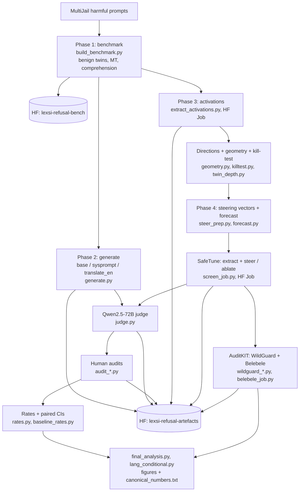

# Is refusal shared across languages? Steering a multilingual model's safety from the inside

Lexsi AI Safety & Alignment Hackathon, Track 2 (Nov 2026). Model: [CohereLabs/tiny-aya-global](https://huggingface.co/CohereLabs/tiny-aya-global).

**Article:** [CONFIRM: HF article link] · **Benchmark:** [anantshri1/lexsi-refusal-bench](https://huggingface.co/datasets/anantshri1/lexsi-refusal-bench) · **Artefacts** (generations, judgements, human audits, activations, directions; gated): [anantshri1/lexsi-refusal-artefacts](https://huggingface.co/datasets/anantshri1/lexsi-refusal-artefacts)

> **Content warning.** The benchmark and artefacts contain harmful prompts and model completions. Safety research only.

## TL;DR
- **There is a gap.** On harmful requests the model understood, Tiny Aya complies 5% of the time in English, 13% in Italian, 16% in German and **23% in Hindi** (Hindi +17 pp over English, 95% CI 9.5–25.8). Benign over-refusal stays ~0–5% everywhere, so this is under-refusal, not general caution.
- **The mechanism is shared, the signal is lost.** The English refusal direction separates harmful from benign in it/de/hi as well as in English, and a Hindi-specific direction is ~0.90–0.96 aligned with it. What fails is local: a subset of prompts loses part of its harm signal in the middle layers and drops out of the zone where the model refuses.
- **One internal push closes most of it.** Adding the English refusal direction at one layer (slot 24, 0.2 of the English harmful–benign separation) cuts Hindi compliance **22.6% → 8.6%** (paired −14.0 pp [−21.7, −6.5]), matching translate-to-English (8.7%) in **one pass, answering in Hindi**, and beating a safety system prompt (15.1%). A food/travel control direction and a random one at the same push size do nothing. Cost: over-refusal on harmless *requests* 2–4% in every language; more pushback on harmless *statements*, so total Hindi over-refusal is 9.6% (translate-to-English 5.4%; human-corrected, resting on a few rows); reading comprehension (Belebele) −0.1 to −0.8 pp.

## Question and hypotheses
Multilingual models refuse harmful prompts less outside English. Is that because
**(A)** refusal is one shared mechanism that fires more weakly in other languages,
**(B)** each language has its own, weaker mechanism, or
**(C)** the representation is shared but the readout differs by language?
Answer: **A in a local form, plus a C-like softer readout outside English; B disfavoured** (with a power caveat: r_en and r_hi are 0.90-aligned at slot 24).

*Phase 3. (A) Along the English refusal direction, harmful and benign prompts separate almost as well in it/de/hi as in English; Malayalam and romanised Hindi, which the model largely does not understand, collapse. (B) The refusal direction transfers across languages exactly as much as a neutral topic direction (food vs travel): it is a shared concept, not a special one. (C) Prompts that fail in a language lose an extra ~15–20% of the English harm separation in the middle layers.*

## How it was done (one phase per summary)
| phase | question | summary |
|---|---|---|
| 1 Benchmark | 133 MultiJail harmful prompts (100 H_core requests + 33 H_bait statements) with matched benign twins, in en/it/de/hi/ml + romanised Hindi; comprehension control | [`data/frozen/README.md`](data/frozen/README.md) |
| 2 Behaviour | is there a gap among understood prompts? baselines: system prompt, translate-to-English | [`PHASE2_SUMMARY.md`](PHASE2_SUMMARY.md) |
| 3 Mechanism | does the English refusal direction transfer? where is the signal lost? | [`PHASE3_SUMMARY.md`](PHASE3_SUMMARY.md) |
| 4 Intervention | can steering along it close the gap, at what cost? | [`PHASE4_SUMMARY.md`](PHASE4_SUMMARY.md) |

Every prediction was written down before its run ([`PREDICTIONS.md`](PREDICTIONS.md), including the ones that failed). Every reported number is in [`canonical_numbers.txt`](canonical_numbers.txt). Each phase started with a kill-test: the cheapest evaluation that could make the headline disappear.

## Evaluation in brief
- **Refusal judge:** Qwen2.5-72B-Instruct (rubric [`JUDGE_RUBRIC.md`](JUDGE_RUBRIC.md)), validated against human labels; reads responses in the input language.
- **Over-refusal is always human-corrected:** the judge's precision on benign refusals was ~0.2, so every flagged row and a stratified sample of unflagged rows were labelled by hand.
- **Second judge:** WildGuard, used only where it was validated (benign twins of requests), never averaged with the primary judge.
- **Statistics:** paired bootstrap CIs over prompt pairs; steering directions cross-fitted (5 folds by pair) so no prompt is steered by a direction built from itself.

## Lexsi toolkits used
- **SafeTune** ([Lexsi-Labs/SafeTune](https://github.com/Lexsi-Labs/SafeTune) @ 26f59e6): refusal-direction extraction (cross-checked against ours, cos 1.000), steering and all-layer ablation in every Phase 4 run.
- **AuditKIT** ([Lexsi-Labs/AuditKIT](https://github.com/Lexsi-Labs/AuditKIT) @ 71316da): WildGuard guard judge; Belebele utility via its native log-likelihood engine with the SafeTune hook installed.
- **CuratorKIT / CircuitKIT**: assessed (RECCE.md), not used in the results.

## Pipeline

## Repository map
| path | what |
|---|---|
| `src/paths.py` | the only place paths are defined; [`PATHS.md`](PATHS.md) is the file contract (naming, schemas, HF layout) |
| `src/build_benchmark.py`, `build_control.py`, `comprehension_final.py` | Phase 1: benchmark, control set, comprehension filter |
| `src/generate.py`, `judge.py`, `audit_*.py`, `baseline_rates.py`, `rates.py` | Phase 2: generation, judging, human audits, rates and CIs |
| `src/extract_activations.py`, `geometry.py`, `killtest.py`, `twin_depth.py`, `cosine.py` | Phase 3: activations (HF Job), directions, geometry, kill-test |
| `src/steer_prep.py`, `forecast.py`, `screen_*.py`, `full_split.py`, `final_analysis.py`, `lang_conditional.py`, `belebele_job.py`, `wildguard_*.py` | Phase 4: steering vectors, no-GPU forecast, screening, full runs, analysis, utility, second judge |
| `src/test_*.py` | Mac-side checks of the single-file HF Job scripts |
| `figures/` | figures and their CSVs (`p3_*`, `p4_*`) |
| [`RECCE.md`](RECCE.md) | toolkit reconnaissance and traps hit (T1–T5) |
| [`LITERATURE.md`](LITERATURE.md) | related work map |

## Reproducing
- Python 3.13, pinned versions in `requirements.txt`; toolkits installed from source at the commits above.
- GPU work ran as [HF Jobs](https://huggingface.co/docs/huggingface_hub/guides/jobs) with single-file PEP 723 scripts, e.g. `hf jobs uv run --flavor t4-small --timeout 1h --secrets HF_TOKEN src/screen_job.py --stage full` (Belebele and WildGuard on `l4x1`). The judge runs from a laptop through HF Inference Providers (`LEXSI_JUDGE_PROVIDER`, default `featherless-ai`; Phase 4 full runs `deepinfra`).
- Model `CohereLabs/tiny-aya-global` at sha af89d219, transformers 5.22.0, greedy decoding.
- Layer naming: we say **slot k** = residual stream after decoder layer k−1. SafeTune's `layers=[i]` indexes decoder blocks, so **SafeTune index = slot − 1**.

## Limitations
One 3B-class model; one primary judge family; a single human annotator (the author; native Hindi). Malayalam and romanised Hindi were largely not understood by the model and are excluded from headline comparisons. Hindi over-refusal estimates rest on a handful of rows. Greedy, length-capped generation only. Details in each phase summary.

## Licence
Code: [Unlicense](LICENSE). Data: CC BY-NC 4.0 (see the dataset cards).

## Acknowledgements
Built with Claude (Anthropic) as a pair-programming and analysis partner: design discussions, code drafts and reviews. All runs, human labels and final decisions are the author's.
